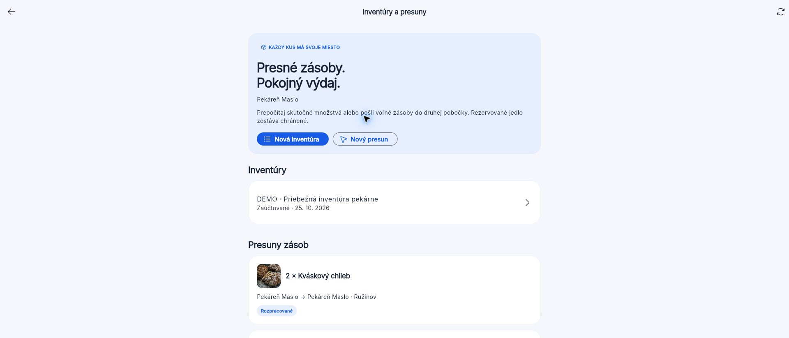
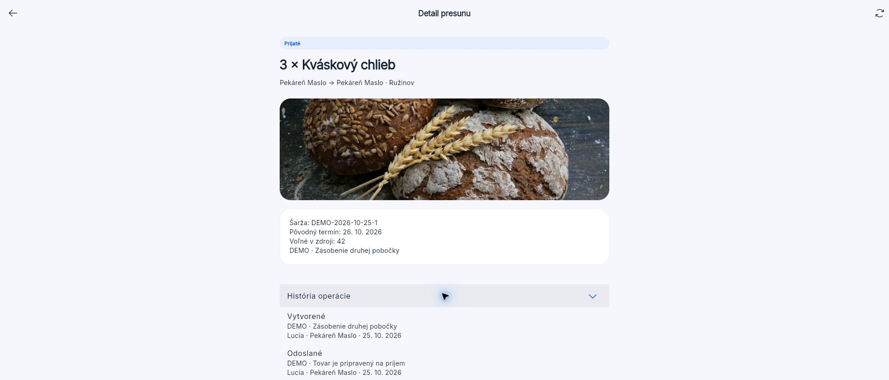
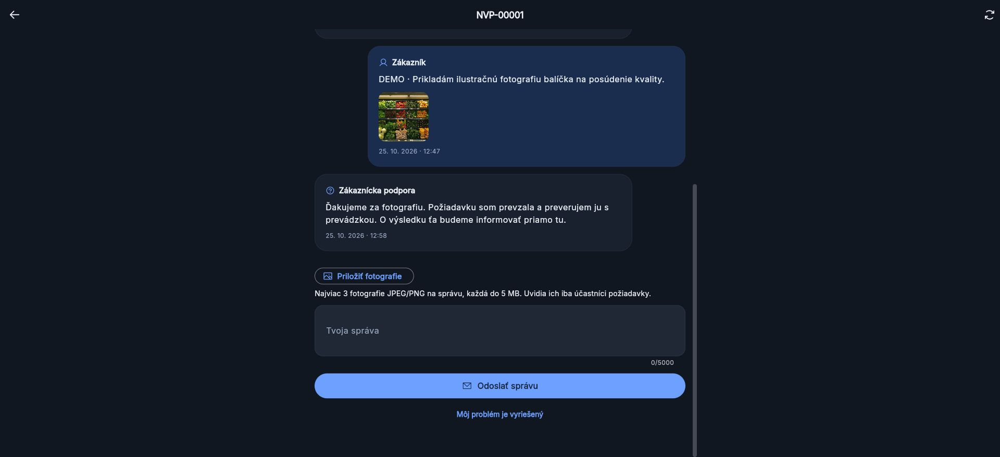

# Save Food · doplnenie 25. 10. 2026

Úplná sada po doplnení Firebase a zmene identifikátorov: analyzer bez nálezov, 288 testov (30 doménových, 171 API, 3 HTTP, 3 perzistencia, 81 Flutter). Nových 22 serverových a 5 klientskych Firebase scenárov, tri testy pripnutého fakturačného modelu. Docker obraz bol znovu zostavený a spustený v produkčnom režime s merchantSeller, vypnutými platbami a bez aktivovaného Firebase projektu. Konfigurácia HTTPS/IP Caddy 2.11.7 a Compose prešla lokálnou validáciou; verejný certifikát a nasadenie čakajú na pridelenú IP. Apple Team QQ3UCX8XGK používateľ potvrdil. Nové tri weby, oba Save Food APK a iOS simulátorová zostava prešli; AAPT aj zostavený iOS Info.plist potvrdili com.dakoty.savefood a Save Food. Ďalšie detaily: [FIREBASE.md](FIREBASE.md), [HETZNER.md](HETZNER.md).

Nasledujú staršie overenia pred premenovaním.

# Overenie prevádzkových tokov · 25. 10. 2026

Aktuálne doplnenie: [DOKONCENIE.md](DOKONCENIE.md) a [STAV.md](STAV.md). Posledná sada má 258 testov a dva samostatne úspešné obrazové exporty, tri webové vstupy, PDF doklady, bezpečné účty a nové skladové/účtovné konektory. Nižšie zostáva záznam skoršieho overenia operations-v2.

Platby sú podľa aktuálneho zadania odložené na záverečné zapojenie. Toto rozšírenie sa týka skladu, inventúr, presunov a zákazníckej podpory. Pri overovaní sa neuskutočnila skutočná platba ani externá správa.

## Automatické kontroly

`bash tool/check.sh` dokončený úspešne: analyzer bez nálezov, 201 testov prešlo (doména 30, server 95, HTTP klient 3, perzistencia 3, Flutter 70). Dva voliteľné exporty náhľadov zostali preskočené. Po finálnej úprave slovenského názvu skladovej jednotky prešiel opakovane analyzer a sedem testov nových Flutter obrazoviek.

Nové testy kontrolujú konzerváciu množstva počas presunu, ochranu rezervácií, fyzický návrat do karantény, zneplatnenie inventúrnej predlohy pri súbežnom pohybe, oprávnenia a opakovanie požiadaviek. Stiahnutie zdrojovej šarže z predaja sa prenáša aj na už prijaté odvodené šarže. História operácií nad 100 záznamov zostáva dostupná cez stránkovanie.

Podpora má testy súkromia fotografií a interných poznámok, odmietnutia neplatných obrazov, úplnej histórie nad 50 správ, normalizovaného vyhľadávania, priradenia, auditu a čítania iba načítaného snapshotu. FCM fronta sa preverila náhradným poskytovateľom vrátane odhlásených relácií. Nové obrazovky majú kontroly rozloženia pri šírkach 375 a 1440 bodov v oboch témach.

## Zostavenia

- Zákaznícky aj predajcovský web: release zostavenie úspešné, API `http://127.0.0.1:8080`.
- Android: debug APK úspešné; `artifacts/nevyhadzuj-demo.apk` obsahuje samostatné zákaznícke demo. Serverové sklady a podpora vyžadujú klienta nakonfigurovaného na API.
- iOS: debug zostavenie pre iPhone 17 Pro simulátor úspešné cez konkrétny simulator destination a `ONLY_ACTIVE_ARCH=YES`. Nový plugin fotografií je zahrnutý. Nejde o podpísanú distribúciu ani overenie fyzického fotoaparátu.

## Ručné overenie cez skutočný web a server

Použitá samostatná inštancia `DEMO_INSTANCE=operations-v2`, databáza `data/demo-operations-v2.sqlite`. Pôvodné showcase dáta ostali zachované aj v zálohe `data/demo-showcase-preserved-20261025.sqlite`.

1. Pekáreň Maslo: Sklad → Inventúry a presuny zobrazí pripravenú inventúru, koncept presunu a tovar na ceste.
2. Fyzický príjem troch kusov chleba do Ružinova bol potvrdený bez schválenia kvality. Stav sa zmenil na Prijaté; cieľová samostatná šarža má 3 kusy, pôvodný termín a stav Na kontrolu. Audit obsahuje vytvorenie, odoslanie a príjem.
3. Dokončené fyzické počty všetkých šiestich šarží, uloženie a schválenie inventúry. Stav Zaúčtované, rozdiel 0; rezervované jednotky ostali pokryté.
4. Nina: otvorená fotografická reklamácia, priradená operátorke a odoslaná verejná odpoveď vo fiktívnej konverzácii. Interná poznámka je viditeľná iba na pracovisku podpory.
5. Sofia: upozornenie otvorilo správny tiket, fotografia sa načítala a otvorila vo vlastnom náhľade. Odpoveď operátorky je viditeľná, interná poznámka chýba. Po návrate do centra bola udalosť označená ako prečítaná; iný tiket zostal neprečítaný.
6. Vizuálna kontrola svetlého skladu a tmavej zákazníckej podpory.

Snímky skutočného webu:

## Hranice overenia

Živé platby, produkčné FCM/APNs, OAuth účty a konkrétny ERP partnera ostávajú závislé od ich konfigurácie. E-mail/SMS sa neposielajú. Veľké reťazce potrebujú záťažové overenie a konkrétne integračné mapovanie; server používa jeden SQLite proces a celé jednotky kus/balenie/porcia. Úspešné testy a demo nie sú tvrdením o 100 % pripravenosti ostrej prevádzky.
